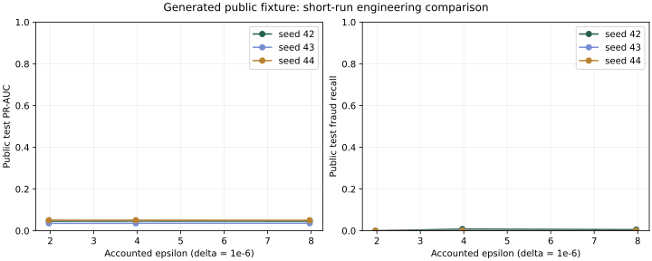

# Recorded public engineering benchmark

Source: generated fixture, not PaySim or real-bank data. Three rounds, 12 local steps per round,
capacity 2,048, expected batch 128, clipping norm 1, fixed learning rate 0.1, validation epsilon 0.5.
Three seeds per budget; each is an independent public simulation, not a reset private budget.

These short-run models do not satisfy the release policy. No qualifying fraud-detection performance is claimed.
Variation across these runs does not establish a monotonic privacy–utility relationship.

| Planned epsilon | Accounted epsilon | Mean PR-AUC ± sample SD | Mean recall | Runs |
|---|---|---|---|---|
| 2.0 | 1.9674 | 0.0442 ± 0.0078 | 0.00% | 3 |
| 4.0 | 3.9666 | 0.0444 ± 0.0076 | 0.33% | 3 |
| 8.0 | 7.9666 | 0.0443 ± 0.0072 | 0.18% | 3 |

Mean full-job wall time: 20.1 seconds.
Full-job time includes public baselines and attacks; it is not isolated secure-aggregation latency.
Communication counts are local framed protocol bytes; TLS framing overhead is not included in this study.
Each JSON result retains institution metrics, receipts, attack controls, baselines, and release reasons.
No dataset occupancy or raw records are used as billing telemetry.
