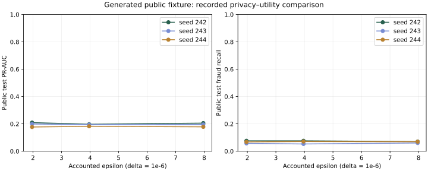

# Recorded public engineering benchmark

Source: generated fixture, not PaySim or real-bank data.
5 rounds; 100 local steps per round; capacity 8192; expected batch 128; clipping norm 1; learning rate 0.5; validation epsilon 0.5.
Three seeds per budget; each is an independent public simulation, not a reset private budget.

These models do not satisfy the release policy. No qualifying fraud-detection performance is claimed.
Variation across these runs does not establish a monotonic privacy–utility relationship.

| Planned epsilon | Accounted epsilon | Mean PR-AUC ± sample SD | Mean recall | Runs |
|---|---|---|---|---|
| 2.0 | 1.9684 | 0.1950 ± 0.0165 | 6.70% | 3 |
| 4.0 | 3.9672 | 0.1913 ± 0.0079 | 6.66% | 3 |
| 8.0 | 7.9680 | 0.1929 ± 0.0137 | 6.65% | 3 |

Mean full-job wall time: 30.8 seconds.
Full-job time includes public baselines and attacks; it is not isolated secure-aggregation latency.
Communication counts are local framed protocol bytes; TLS framing overhead is not included in this study.
Each JSON result retains institution metrics, receipts, attack controls, baselines, and release reasons.
No dataset occupancy or raw records are used as billing telemetry.
